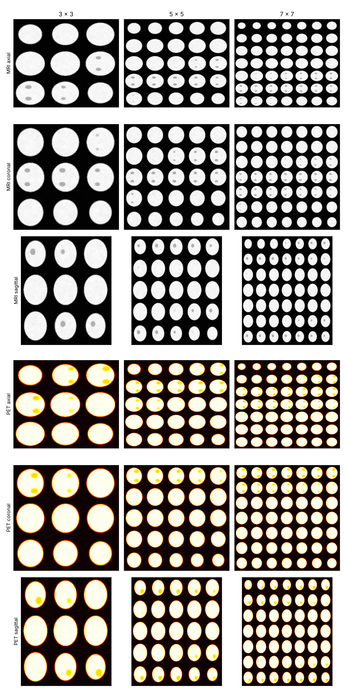

# Image Casting and Fusion of MRI and PET for Predicting Alzheimer's Disease

[](https://github.com/dijifakoya/alzheimers-mri-pet-fusion/actions/workflows/tests.yml)


Code for the paper:

> **A. A. Fakoya and S. Parkinson**, "A Novel Image Casting and Fusion for Identifying Individuals at Risk of Alzheimer's Disease Using MRI and PET Imaging," *IEEE Access*, 2024. [DOI: 10.1109/ACCESS.2024.3412850](https://doi.org/10.1109/ACCESS.2024.3412850)

People with **mild cognitive impairment (MCI)** are at higher risk of developing **Alzheimer's disease (AD)**, but not all of them will. This project predicts which people with MCI will **progress to AD within three years** (progressive MCI, pMCI) and which will remain stable (sMCI), using two kinds of brain scan:

- **Structural MRI**, which shows brain shrinkage (atrophy)
- **FDG-PET**, which shows changes in brain metabolism

3D scans are slow and expensive to model directly with deep learning. This method **casts each 3D scan into a single 2D image**: slices from one anatomical view are arranged in a grid, from 1 × 1 up to 7 × 7. The best MRI and PET images (coronal view, 6 × 6 grid) are then **fused at pixel level** into one 6-channel image and classified by a single 2D convolutional neural network (CNN).


*Image casting of one subject into 3 × 3, 5 × 5 and 7 × 7 mosaics in the axial, coronal and sagittal views. Shown on synthetic data generated by this repository, not real patient scans.*

---

## Key results (from the paper)

Task: **stable MCI (sMCI) vs progressive MCI (pMCI, converted to AD within 3 years)**, ADNI data.

| Model | Input | Accuracy |
|---|---|---|
| **Spatial-domain fusion, 2D CNN (proposed)** | **MRI + PET, coronal 6 × 6, 6-channel fused image** | **94%** (AUC 0.93) |
| Feature-level fusion, ResNet101V2 + ResNet101 | MRI + PET, coronal 6 × 6 | 85% |
| Pre-trained ResNet50V2 / ResNet101V2 | MRI, coronal 6 × 6 | 87% |
| 2D CNN | MRI, coronal 6 × 6 | 85% |
| 3D CNN | MRI, full volume | 77% |
| Pre-trained ResNet101 | PET, coronal 6 × 6 | 77% |
| 2D CNN | PET, coronal 6 × 6 | 74% |
| 3D CNN | PET, full volume | 61% |

**Speed:** training the 2D models took **0.285%** of the time needed by a 3D CNN for the same task (about 4 minutes for 30 epochs on the coronal 6 × 6 MRI images, compared with over 52 hours for the 3D CNN).

<details>
<summary>Accuracy (%) for every view and grid size</summary>

**MRI**

| View | 1 | 2 × 2 | 3 × 3 | 4 × 4 | 5 × 5 | 6 × 6 | 7 × 7 |
|---|---|---|---|---|---|---|---|
| Axial | 75 | 77 | 78 | 81 | **84** | 83 | 78 |
| Coronal | 72 | 79 | 80 | 81 | 83 | **85** | 84 |
| Sagittal | 74 | 74 | 78 | 80 | **81** | 76 | 73 |

**PET**

| View | 1 | 2 × 2 | 3 × 3 | 4 × 4 | 5 × 5 | 6 × 6 | 7 × 7 |
|---|---|---|---|---|---|---|---|
| Axial | 66 | 66 | 69 | 69 | **73** | 71 | 70 |
| Coronal | 67 | 70 | 71 | 72 | 72 | **74** | 70 |
| Sagittal | 65 | 68 | 70 | 68 | 67 | **70** | 69 |

</details>

> **Note on re-running:** this re-implementation keeps all scans from the same participant in the same data split and reports sensitivity, specificity and AUC as well as accuracy. Because some participants have both baseline and 6-month scans, results from this stricter evaluation may differ from those reported in the paper.

---

## What the code does

```
3D MRI ─┐   normalise    cast into an        ┌─ spatial-domain fusion: 6-channel image → one 2D CNN  (paper, 94%)
        ├─► each scan ─► n×n 2D mosaic ─────►├─ feature-level fusion: two CNN branches, features joined (paper, 85%)
3D PET ─┘                (axial/coronal/     └─ decision-level fusion: two branches, predictions averaged (extension)
                          sagittal)                        │
                                                           ▼
                                           P(conversion to AD within 3 years)
```

| Step | Module | Details |
|---|---|---|
| Load and pair scans | `mripet.io` | Reads NIfTI files; pairs each subject's MRI and PET by ADNI subject ID |
| Normalise | `mripet.preprocessing` | MRI clipped to [0, 400] and scaled to [0, 1]; PET min–max scaled per scan |
| Image casting | `mripet.casting` | n × n slices from one view arranged in a 2D grid (slice choices for each grid size in `GRID_PRESETS`) |
| Fusion | `mripet.fusion`, `mripet.models` | Spatial-domain fusion (6-channel image, as in the paper; also 2-channel, sum and average), feature-level fusion (optionally a different pre-trained network per branch), decision-level fusion |
| CNN | `mripet.models` | Thesis network: 5 × [Conv2D → MaxPool → BatchNorm] (16-32-32-64-64 filters), Dense 128, Dropout 0.3, sigmoid; L2 = 0.01. Pre-trained backbones (VGG16, ResNet101V2, DenseNet121…) also available |
| Training | `mripet.train` | Adam with exponential learning-rate decay, rotation augmentation (±5°, ±10°), early stopping |
| Evaluation | `mripet.cross_validate`, `mripet.metrics` | Subject-level stratified k-fold cross-validation; accuracy, sensitivity, specificity, precision, F1, AUC, ROC curves |
| Explainability | `mripet.explain` | Grad-CAM heat maps showing which regions drove each prediction (per modality for fusion models) |
| Full comparison | `mripet.run_grid` | Every view × grid size × modality × fusion level |

### Reproducibility safeguards
- **Subject-level splits:** all scans from one person stay in the same training, validation or test set, which prevents data leakage.
- **Per-scan normalisation:** no statistics are shared between training and test data.
- **Threshold chosen on validation data only:** the decision threshold (Youden's J) is never tuned on the test set.
- **Fixed random seeds** and a saved copy of the exact settings (`config_used.yaml`) for every run.
- **Automated tests** check that the image casting reproduces the original thesis implementation exactly, and that the full pipeline runs end to end.

---

## Repository structure

```
alzheimers-mri-pet-fusion/
├── configs/
│   ├── default.yaml          # settings for ADNI experiments
│   └── synthetic.yaml        # quick run on synthetic data
├── data/README.md            # how to obtain and arrange the ADNI data (no data is stored here)
├── docs/                     # figures and notes on the original notebooks
├── notebooks/01_quickstart.ipynb
├── src/mripet/
│   ├── io.py                 # load scans, build subject manifest
│   ├── preprocessing.py      # normalisation, shape checks
│   ├── casting.py            # 3D → 2D image casting
│   ├── fusion.py             # image-level fusion
│   ├── models.py             # CNN and fusion architectures
│   ├── augment.py            # rotation augmentation
│   ├── splits.py             # subject-level stratified splits
│   ├── train.py              # train + evaluate on a held-out test set
│   ├── cross_validate.py     # k-fold cross-validation
│   ├── run_grid.py           # full comparison of views/grids/modalities
│   ├── explain.py            # Grad-CAM
│   ├── metrics.py            # metrics and plots
│   ├── synthetic.py          # synthetic data generator for testing
│   └── visualise.py          # casting figure
├── tests/                    # pytest test suite
├── pyproject.toml
├── requirements.txt
└── environment.yml
```

---

## Getting started

### 1. Install
```bash
git clone https://github.com/dijifakoya/alzheimers-mri-pet-fusion.git
cd alzheimers-mri-pet-fusion
python -m venv .venv && source .venv/bin/activate      # Windows: .venv\Scripts\activate
pip install -e ".[dev]"
# Apple Silicon Mac (optional GPU acceleration): pip install tensorflow-metal
```

### 2. Try it on synthetic data (no ADNI access needed, about 2 minutes on a laptop)
```bash
python -m mripet.synthetic --out data/synthetic/raw --n-per-class 50
python -m mripet.io --config configs/synthetic.yaml
python -m mripet.train --config configs/synthetic.yaml
```
Results, figures and the settings used are saved to `results/synthetic/`.
*Synthetic results only show that the code runs; they say nothing about real-world performance.*

### 3. Run on ADNI data
1. Apply for ADNI access and arrange the scans as described in [`data/README.md`](data/README.md).
2. Build the manifest:
   ```bash
   python -m mripet.io --config configs/default.yaml
   ```
3. Train and test the paper's best model (spatial-domain fusion, coronal 6 × 6 — the default settings):
   ```bash
   python -m mripet.train
   ```
   Other configurations, for example MRI only or feature-level fusion:
   ```bash
   python -m mripet.train --modality mri --view axial --grid 5
   python -m mripet.train --modality fusion --fusion-level feature --view coronal --grid 6
   ```
4. Five-fold cross-validation:
   ```bash
   python -m mripet.cross_validate
   ```
5. Compare all views, grid sizes and modalities:
   ```bash
   python -m mripet.run_grid
   ```
6. Grad-CAM explanations for a trained model:
   ```bash
   python -m mripet.explain --model models/holdout/fusion_coronal_6x6_image-six_channel/best_model.keras
   ```

All settings (normalisation, slice selection, architecture, learning rate, augmentation, folds) live in `configs/default.yaml`. Any option can also be set on the command line, as above.

### 4. Run the tests
```bash
pytest
```

---

## Data acknowledgement

Data used in this work were obtained from the Alzheimer's Disease Neuroimaging Initiative (ADNI) database (adni.loni.usc.edu). The investigators within ADNI contributed to the design and implementation of ADNI and/or provided data but did not participate in the analysis or writing of this work.
<!-- Check the exact acknowledgement wording required by your ADNI data use agreement. -->

**No ADNI data, derived images or trained model weights are included in this repository.**

---

## Citation

```bibtex
@article{fakoya2024imagecasting,
  author  = {Fakoya, Adediji A. and Parkinson, Simon},
  title   = {A Novel Image Casting and Fusion for Identifying Individuals at Risk of Alzheimer's Disease Using MRI and PET Imaging},
  journal = {IEEE Access},
  year    = {2024},
  doi     = {10.1109/ACCESS.2024.3412850}
}
```

## Author

**Dr Adediji Fakoya, PhD, FHEA** — data scientist and lecturer in computing
[LinkedIn](TODO) · [Google Scholar](TODO) · adediji.fakoya@gmail.com

## Licence

MIT — see [LICENSE](LICENSE).
